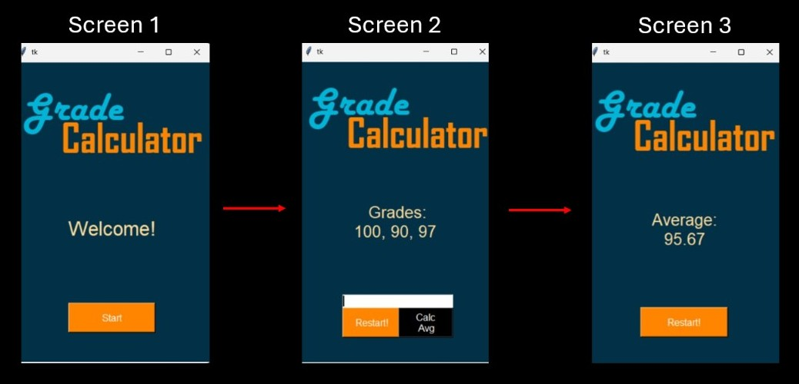

# Music Scale Generator Lab AP Create Task

    <strong>GUI Walkthrough for students taking AP Computer Science Principles.</strong>

 

    First-year programming students learn to code a graphic user interface in Python tKinter for the AP Create Performance Task.

  

  

In this in-class walkthrough, students learn how to code a graphic user interface (GUI) that calculates their grade average. This is a cumulative project that reviews all of what has been learned in the year and covers all of the requirements for submission to the AP Create Task which will be 30% of the students grade on the AP test.
  
In the walkthrough, students learn to build a screen with a frame to arrange their app in sections. This lesson is covered over several days. Checkpoints are uploaded to the LMS each class day so that students don't fall behind if they miss class or are encumbered by errors during class.
  
After completion of this walkthrough, students are given a major project to build out a tKinter app following a similar structure that allows the user to generate the notes of a musical scale given a certain key and which scale they choose from dropdown menus.

## What Is Learned:

- How to design an app in Python tKinter to solve a real-world problem or necessity.
- How to design the color scheme and layout of an app in Python tKinter.
- Using text fields in tKinter to intake data as a list, run calculations on the data, and reproduce the new data as output on screen.
- How to use event handlers to bind keys to the app.

## How to Use:

- Enter as many grades as you would like into the text box and press "calc average".
- The average of grades shows up as output on the next screen.
